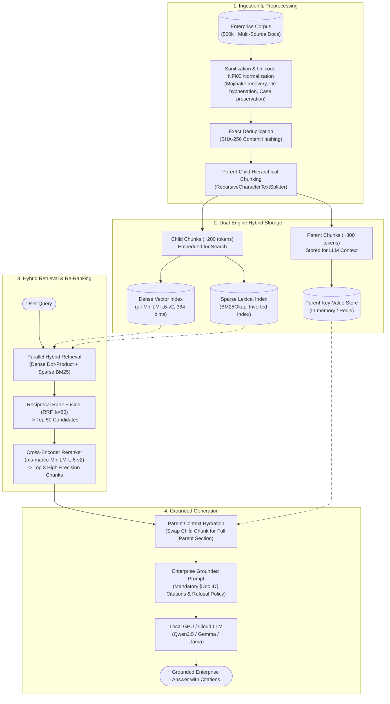

# Enterprise RAG Benchmark & Production Pipeline

[](https://www.python.org/)
[](https://astral.sh/uv)
[](https://huggingface.co/datasets/ingalepratap/EnterpriseRAG-Bench)
[](https://opensource.org/licenses/MIT)

An **industry-standard, enterprise-grade Retrieval-Augmented Generation (RAG) system** engineered and benchmarked against **500,000+ internal documents** across 9 heterogeneous SaaS connectors (Slack, Gmail, Jira, Confluence, Linear, HubSpot, GitHub, Fireflies, Google Drive) using the [`EnterpriseRAG-Bench`](https://huggingface.co/datasets/ingalepratap/EnterpriseRAG-Bench) dataset.

---

## Architecture Overview



---

## Core Enterprise Principles Implemented

1. **Source-Aware Sanitization & Normalization**:
   * Unicode `NFKC` normalization for ligature decomposition (`fi` $\to$ `f` + `i`) and mojibake repair.
   * Case and morphology preservation: Acronyms (`AWS`, `SLA`, `CEO`, `P0`) are strictly preserved to maintain dense semantic precision.
   * Exact deduplication using `SHA-256` hashing (identified 1,572 exact duplicate records in the benchmark).
2. **Parent-Document (Hierarchical / Small-to-Big) Chunking**:
   * Solves the **Semantic Dilution Problem**: Child chunks (~150–200 tokens) are embedded for sharp vector similarity, while parent chunks (~600–800 tokens) are hydrated for LLM synthesis.
   * Complete metadata lineage tracked per chunk: `child_id -> parent_id -> doc_id -> source_type`.
3. **Dual-Engine Hybrid Indexing (Dense + Sparse)**:
   * **Sparse BM25 Index**: Inverted index matching exact ticket numbers (`ENG-4029`), error codes, and employee names.
   * **Dense Vector Index**: $L_2$-normalized embeddings (`all-MiniLM-L6-v2`, 384 dimensions) enabling single-operation dot-product cosine similarity.
4. **Reciprocal Rank Fusion (RRF)**:
   * Unifies incompatible score scales (BM25 vs. Cosine) using rank reciprocal summation ($k=60$).
5. **Cross-Encoder Re-Ranking**:
   * Two-stage retrieval funnel: Top-50 hybrid candidates are scored via joint all-to-all cross-attention (`cross-encoder/ms-marco-MiniLM-L-6-v2`), pruning candidates down to the Top-3 with proven rank-promotion of ground truth.
6. **Grounded Generation & Guardrails**:
   * Strict system instructions enforcing inline attribution (`[Doc ID: dsid_xxx]`).
   * Explicit out-of-corpus refusal guardrails (*"Information not found in internal documents"*) to eliminate hallucinations.
   * Low-latency local GPU acceleration powered by NVIDIA CUDA (e.g. RTX 4050 / Ampere / Ada).

---

## Project Structure

```text
rag_benchmark/
├── pyproject.toml              # Project dependencies & package configuration
├── uv.lock                     # Deterministic dependency lockfile
├── .gitignore                  # Enterprise-grade secrets and cache isolation
├── .env.example                # Template environment variables
├── README.md                   # System documentation & quickstart
├── docs/
│   └── learnings.md            # Detailed enterprise architectural reference
├── notebooks/
│   ├── dataset_loading_test.ipynb  # Initial dataset inspection
│   └── rag_practice.ipynb          # End-to-end prototype from cleaning to generation
└── src/
    └── rag_benchmark/          # Modular production package
        ├── __init__.py
        ├── config.py           # Pipeline hyperparameters
        ├── ingestion/          # Normalization & Deduplication
        ├── chunking/           # Hierarchical parent-child splitter
        ├── indexing/           # Dense vectors & Sparse BM25
        ├── retrieval/          # Hybrid search & RRF fusion
        ├── reranking/          # Cross-encoder joint scoring
        └── generation/         # Context assembly & LLM synthesis
```

---

## Quickstart & Installation

### 1. Prerequisites
* Python `>= 3.12` or `3.13`
* [`uv`](https://astral.sh/uv) (Extremely fast Python package and project manager)
* (Optional) NVIDIA GPU with CUDA for local LLM acceleration

### 2. Environment Setup
Clone the repository and install all dependencies using `uv`:

```bash
# Clone the repository
git clone https://github.com/mrajpurohit1912/rag_benchmark.git
cd rag_benchmark

# Install virtual environment and dependencies
uv sync
```

### 3. Configure Secrets
Copy `.env.example` to `.env.dev` and add your Hugging Face or provider tokens:

```bash
cp .env.example .env.dev
```

Edit `.env.dev`:
```env
HUGGINGFACE_TOKEN=your_token_here
```

### 4. Run the Practice Notebook
Launch Jupyter to explore the verified step-by-step pipeline:

```bash
uv run jupyter lab
```
Open [`notebooks/rag_practice.ipynb`](notebooks/rag_practice.ipynb) to inspect the ingestion, chunking, indexing, hybrid search, reranking, and local generation outputs.

---

## Dataset & Benchmark Citation

This project is built and benchmarked against **`EnterpriseRAG-Bench`**:

```bibtex
@misc{sun2026enterpriseragbench,
      title={EnterpriseRAG-Bench: A RAG Benchmark for Company Internal Knowledge},
      author={Yuhong Sun and Joachim Rahmfeld and Chris Weaver and Roshan Desai and Wenxi Huang and Mark H. Butler},
      year={2026},
      eprint={2605.05253},
      archivePrefix={arXiv},
      primaryClass={cs.IR}
}
```

---

## License

This project is licensed under the MIT License - see the LICENSE file for details.
