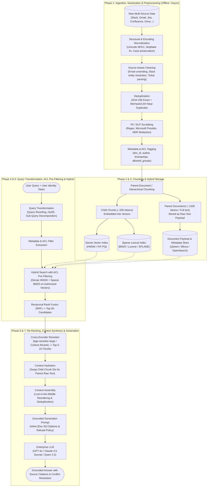

# Enterprise RAG Architecture & Engineering Guide

This document captures the end-to-end architectural standards, pipeline stages, techniques, decision matrices, and foundational concepts for building a production-grade, enterprise-scale Retrieval-Augmented Generation (RAG) system.

---

## High-Level System Architecture



---

## Phase 1: Data Cleaning, Sanitization & Preprocessing

Ingesting raw enterprise data directly into embedding models degrades search quality and causes hallucinations. Enterprise data cleaning requires strict, multi-stage normalization.

### 1. Character Encoding & Structural Normalization
* **Encoding & Unicode Fixes**: Run `unicodedata.normalize('NFKC', text)`:
  * **Mojibake Resolution**: Fixes corrupted characters resulting from encoding mismatches (e.g., text encoded in Windows-1252 but decoded in UTF-8, turning `café` into `café` or smart quotes into `’`).
  * **Ligature Decomposition**: In PDFs, character pairs like `fi`, `fl`, and `ae` are often stored as single typographic glyphs (`fi`, `fl`, `æ`). NFKC decomposes `fi` into separate characters `f` and `i`. Without this, searching for `"financial"` yields 0 hits against `"financial"`.
  * **Whitespace & Newlines**: Standardize `\r\n` to `\n`, convert non-breaking spaces (`\u00a0`) to standard spaces (`\x20`), and strip trailing whitespace.
* **Preserving Casing & Morphology (Critical Rule)**:
  * **Do NOT lowercase or stem (plurals $\to$ singular) in modern RAG pipelines.**
  * Unlike 2010-era bag-of-words search, modern transformer embeddings and LLMs are case-sensitive and morphology-aware.
  * Lowercasing destroys critical enterprise context:
    * `IT` (Information Technology) becomes `it` (the pronoun).
    * `CAT` (medical scan / equipment) becomes `cat` (the animal).
    * Acronyms and severity markers (`AWS`, `SLA`, `CEO`, `P0`, `ENG-102`) lose their semantic precision.

### 2. Source-Specific Boilerplate Removal & Thread Unwinding
Each enterprise tool produces distinct noise patterns:
* **Email (Gmail / Outlook)**:
  * Strip corporate legal disclaimers, *"Sent from my iPhone"* footers, and calendar invite attachments.
  * Unwind nested email reply trails (`> On Mon, Oct 12 wrote:`) to index each message as an independent event with author/date metadata.
* **Chat (Slack / Teams)**:
  * **Entity Resolution**: Replace raw user IDs (`<@U04ABC123>`) with readable names (`@Sarah Chen`).
  * **Turn Aggregation**: Group rapid, fragmented consecutive messages sent by the same user within a 5-minute sliding window into a single coherent turn.
* **Issue Trackers (Jira / Linear)**:
  * Serialize semi-structured ticket fields into a standardized schema:
    `[TICKET: ENG-4029] [STATUS: Resolved] [PRIORITY: High] [ASSIGNEE: Alex] Title: ... Description: ... Resolution: ...`
* **Transcripts (Fireflies / Zoom)**:
  * Retain speaker diarization and timestamps (`[00:14:22] David: ...`), and strip conversational filler words (*"um"*, *"uh"*, *"like"*).

### 3. PII Scrubbing & Data Loss Prevention (DLP)
Enterprise compliance (SOC-2, GDPR, HIPAA) mandates redacting sensitive data prior to vector storage and LLM consumption:
* **Tooling**: Microsoft Presidio, transformer-based Named Entity Recognition (NER), or custom regex rules.
* **Target Data**: Mask credit cards, SSNs, personal phone numbers, and secrets (API keys, JWT tokens, private SSH keys) with placeholder tokens (e.g., `<REDACTED_SECRET>`).

### 4. Deduplication: Exact vs. Near-Duplicate
* **Exact Match Deduplication (SHA-256)**:
  * Computes a 64-character cryptographic hash of normalized content.
  * Eliminates exact duplicate documents in $O(1)$ time without calling LLMs.
  * Powers **Change Data Capture (CDC)**: If a document's SHA-256 has not changed during a daily crawl, skip re-embedding.
* **Near-Duplicate Detection (MinHash + LSH / SimHash)**:
  * Identifies documents with high lexical overlap ($>85\%$ Jaccard similarity), such as mass-forwarded email threads or copy-pasted Confluence runbooks.
  * Retains the canonical/newest version and cross-references duplicates in metadata.

### 5. Metadata Tagging & Access Control Lists (ACLs)
Attach queryable metadata to every document payload:
* `doc_id`, `source_type` (slack, confluence, jira), `created_at`, `updated_at`, `author`, `department`.
* `allowed_groups`: Role-Based Access Control list (e.g., `["engineering", "infra-core"]`).

---

## Phase 2: Chunking Techniques & Decision Matrix

Chunking balances embedding retrieval resolution against LLM synthesis capacity.

```
Embedding Optimization (150–300 tokens) ≠ LLM Context Window (1k–128k tokens)
```

### Chunking Strategies
1. **Fixed-Size Chunking**:
   * Slices text strictly by token or character count with a sliding overlap (e.g., 512 tokens, 64-token overlap).
   * Fast, but risks cutting sentences and code blocks mid-thought.
2. **Recursive Character Chunking**:
   * Hierarchical, structure-aware splitting: attempts `\n\n` (paragraphs) first; falls back to `\n` (lines); then sentence boundaries (`. `, `?`, `!`); then words.
   * Keeps logical paragraphs and complete thoughts coherent.
3. **Syntax / AST-Aware Chunking**:
   * Uses tree parsers for Markdown (splitting on `#`, `##` headers), Source Code (classes and functions via Tree-sitter), and Tables (keeps table rows intact; never splits tables across chunks).
4. **Semantic Chunking**:
   * Splits text when the cosine similarity between consecutive sentence embeddings drops below a statistical threshold, isolating topic transitions.
5. **Hierarchical / Parent-Document Chunking (Small-to-Big) [Enterprise Standard]**:
   * **Child Chunks (~150–250 tokens)**: Converted to dense embeddings and indexed in the vector store for high-precision semantic matching.
   * **Parent Chunks (~1000–2000 tokens or full document)**: Stored as raw text in document payloads.
   * **Runtime Flow**: The user query matches a child chunk, but the retriever returns the **parent chunk's full raw text** to the LLM for generation.

### Chunking Decision Matrix

| Data Source / Content Type | Recommended Chunking Strategy | Target Size / Overlap | Rationale |
| :--- | :--- | :--- | :--- |
| **Slack / Teams Chats** | Thread-as-a-Chunk / Turn Window | Full Thread (max 512 tokens, 0 overlap) | Standalone messages lose all context without the thread. |
| **Email Threads (Gmail)** | Message-Level + Parent-Child | Single Email (Parent) + 200-tok Children | Preserves sender, recipient, and reply context. |
| **Confluence / Notion Wikis** | Markdown Header AST + Parent-Child | Child: 256 tokens / Parent: 1200 tokens | Retains section hierarchy while enabling granular search. |
| **Jira / Linear Tickets** | Field-Based Atomic Chunking | Single Ticket (~300–600 tokens) | Tickets are atomic units; do not separate descriptions from comments. |
| **Meeting Transcripts** | Speaker Turn + Semantic Chunking | 400–600 tokens (50-token overlap) | Preserves speaker identity while splitting on topic shifts. |
| **Contracts / Policy PDFs** | Hierarchical (Small-to-Big) | Child: 200 tokens / Parent: 1500 tokens | Preserves legal clause numbers and definitions. |
| **Source Code (GitHub)** | AST-Based (Tree-Sitter) | Class/Function level (200–800 tokens) | Retains complete function signatures, docstrings, and logic. |

---

## Phase 3: Indexing & Storage Architecture

Enterprise search requires storing dense vectors, lexical indexes, and relational metadata payloads within a single hybrid engine.

### 1. Dense Vector Indexing (Semantic Concepts)
* **HNSW (Hierarchical Navigable Small World)**:
  * Multi-layer graph index providing $O(\log N)$ query latency and $>95\%$ recall.
  * Standard for datasets up to tens of millions of vectors.
* **IVF-PQ (Inverted File with Product Quantization)**:
  * Compresses vectors into compact byte codes and clusters into Voronoi cells.
  * Memory-efficient for massive datasets (100M+ vectors) where RAM is constrained.
* **Distance Metrics**:
  * **Cosine Similarity**: Measures angle between vectors; invariant to text length.
  * **Dot Product / Inner Product (IP)**: Best when embedding vectors are normalized to unit length ($L_2 = 1.0$), providing fast SIMD matrix operations.
  * **Euclidean Distance ($L_2$)**: Measures geometric distance; sensitive to vector magnitude.

### 2. Sparse Lexical Indexing (Keywords & Acronyms)
* **BM25 / Lucene Inverted Index**:
  * Indexes token frequencies (TF-IDF).
  * Guarantees exact matches on error codes (`ERR_CONN_RESET`), ticket numbers (`ENG-4029`), UUIDs, and domain-specific acronyms where dense embeddings struggle.
* **Learned Sparse Embeddings (SPLADE / BM42)**:
  * Neural models that expand queries and documents with relevant synonyms while maintaining an inverted index format.

### 3. Payload & Metadata Storage
* Indexes scalar fields (`created_at`, `source_type`, `allowed_groups`) using B-trees or hash maps for hard pre-filtering.
* Supported Databases: **Qdrant**, **Milvus**, **Weaviate**, **OpenSearch**, and **pgvector**.

---

## Phase 4: Pre-Retrieval Query Understanding & Transformation

Enterprise queries are frequently conversational, incomplete, or multi-faceted. Raw queries should not be passed directly to the vector store.

### 1. Query Rewriting & Coreference Resolution
* Resolves conversational references and pronouns:
  * Input: *"How does it compare to their previous release?"*
  * Rewritten: *"How does Redwood Inference v2 latency compare to v1 latency?"*

### 2. HyDE (Hypothetical Document Embeddings)
* Uses an LLM to generate a hypothetical answer passage before searching.
* **Why it works**: In vector space, documents are closer to other documents than questions are to documents. Embedding the hypothetical answer bridges the vocabulary gap between questions and technical documentation.

### 3. Query Decomposition (Sub-Query Generation)
* Decomposes comparative or multi-topic questions into independent search queries:
  * Input: *"Compare Q3 revenue in EMEA vs APAC and list primary churn reasons."*
  * Sub-Query 1: *"EMEA Q3 revenue"*
  * Sub-Query 2: *"APAC Q3 revenue"*
  * Sub-Query 3: *"Q3 customer churn reasons"*
* The system executes sub-queries in parallel and merges results.

### 4. Metadata Filter Extraction
* Automatically converts natural language constraints into database filters:
  * Input: *"Show me the Jira bug Alex closed yesterday regarding CUDA memory"*
  * Output Filter: `{"source_type": "jira", "assignee": "Alex", "status": "closed", "created_at": {"$gte": "yesterday"}}`

### 5. DSPy (Declarative Self-Improving Python)
* **Role in RAG**: Replaces manual, brittle prompt engineering by treating LLM pipelines as modular programs.
* Optimizes query formulation, few-shot demonstration selection, and synthesis prompts programmatically using evaluation metrics (e.g., via `MIPROv2` or `BootstrapFewShot`).

---

## Phase 5: Hybrid Retrieval & Access Control (RBAC)

### 1. Parallel Hybrid Search
Executes Dense Vector Search and Sparse BM25 Search concurrently to retrieve the Top-100 candidates from each:
* **Dense**: Captures semantic synonyms and conceptual intent.
* **Sparse (BM25)**: Captures exact keywords, ticket numbers, and names.

### 2. Reciprocal Rank Fusion (RRF)
Merges ranked lists from dense and sparse search into a single unified candidate list:

$$RRF\_Score(d) = \sum_{m \in \{dense, sparse\}} \frac{1}{k + rank_m(d)} \quad (k \approx 60)$$

### 3. ACL Pre-Filtering (Zero Trust Security)
* **Pre-Filtering (Enterprise Standard)**:
  * The user's role tokens are injected as a hard metadata constraint inside the vector database engine prior to vector distance scoring:
    `Filter: {"allowed_groups": {"$in": user.roles}}`
  * Guarantees that unauthorized documents are never inspected, and user queries always return the requested number of relevant hits.
* **Post-Filtering (Anti-Pattern / Security Risk)**:
  * Retrieving the Top-10 documents globally and stripping unauthorized results afterward can discard most or all retrieved items, destroying recall and leaking metadata existence.

---

## Phase 6: Post-Retrieval Re-Ranking & Context Hydration

```
500,000+ Documents
       │
       ▼ [Stage 1: Hybrid Retrieval (Dense Top-100 + BM25 Top-100)]
  ~150 Unique Candidate Chunks
       │
       ▼ [Stage 2: Reciprocal Rank Fusion (RRF)]
   Top-50 Candidates
       │
       ▼ [Stage 3: Cross-Encoder Reranker (bge-reranker-large / Cohere)]
   Top 5–10 High-Precision Chunks
       │
       ▼ [Stage 4: Context Hydration]
   Parent Document Full Text sent to LLM
```

### 1. Cross-Encoder Re-Ranking
* **Bi-Encoder (Retrieval)**: Encodes query and documents separately as single vectors ($O(1)$ dot product). Fast, but misses fine-grained interactions.
* **Cross-Encoder (Reranker)**: Feeds `(Query, Document)` together into a transformer model (`bge-reranker-large`, `Cohere Rerank`). Full cross-attention evaluates every query token against every document token, scoring true semantic relevance.
* Filters out false-positive vector hits and reduces candidate pools from 50+ down to the top 5–10.

### 2. Context Hydration
* Swaps retrieved child chunk IDs for their corresponding **parent document raw text**, ensuring the LLM receives complete surrounding context rather than isolated fragments.

---

## Phase 7: Context Assembly, Synthesis & Guardrails

### 1. Context Assembly & Lost-in-the-Middle Mitigation
* LLMs pay most attention to tokens at the very beginning and very end of the context prompt.
* **Optimization**: Reorder hydrated parent chunks so the highest-scoring documents sit at the start and end of the prompt context, placing lower-scoring documents in the middle.

### 2. Strict Citation Enforcement
* Mandate inline document attribution in the system prompt:
  * *"Every factual statement must be supported by an inline citation using the format [Doc ID: dsid_xxx]. Never make claims without citing the source document."*

### 3. Out-of-Corpus Refusal (Anti-Hallucination Guardrail)
* Explicit instructions for missing knowledge:
  * *"If the provided context does not contain sufficient facts to answer the question, state: 'Information not found in internal documents'. Do not extrapolate or fabricate answers."*

### 4. Handling Contradictory Information
* When documents contain conflicting facts (e.g., an outdated Confluence policy vs. a recent Slack update), instruct the model to report both versions along with their respective dates and sources rather than guessing the correct answer.

---

## Foundational Concepts Reference

### 1. Encoding, Unicode, & Characters
* **ASCII**: 7-bit standard (128 characters) limited to English letters, numbers, and basic symbols.
* **Unicode**: Global dictionary assigning a unique numerical identifier (**Code Point**, e.g., `U+0041`) to every character and emoji across all languages.
* **UTF-8**: The universal variable-width byte-encoding standard (1 to 4 bytes per character) used to store Unicode characters on disk and over networks.
* **Mojibake**: Character corruption caused by decoding bytes with the wrong encoding standard (e.g., `café` becoming `café`).
* **Ligatures**: Typographic character pairings (e.g., `fi` $\to$ `fi`) that must be decomposed via `NFKC` normalization to ensure searchability.

### 2. Hashing Algorithms
* **SHA-256**: A cryptographic, deterministic, one-way 256-bit hash. Produces a 64-character fingerprint used for exact deduplication and change detection.
* **MinHash + LSH**: Locality-Sensitive Hashing used to compute Jaccard similarity and group near-duplicate documents ($>85\%$ overlap).
* **xxHash (XXH3)**: Non-cryptographic, high-speed hash function optimized for in-memory database indexing.

---

## Summary Checklist for Production RAG

| Pipeline Stage | Enterprise Requirement | Production Verification |
| :--- | :--- | :--- |
| **Ingestion** | Unicode NFKC + Mojibake fix + Case preservation | Acronyms (`AWS`, `SLA`) retained; ligatures decomposed. |
| **Cleaning** | Source-aware cleaning + PII masking | Email disclaimers stripped; API keys and secrets redacted. |
| **Deduplication** | SHA-256 exact match + MinHash near-duplicate | Redundant documents and duplicated wiki pages pruned. |
| **Chunking** | Hierarchical / Parent-Document (Small-to-Big) | 200-tok child for vector index; 1200-tok parent for LLM context. |
| **Indexing** | Hybrid Vector DB (HNSW + BM25 + Payload) | Dense semantic search + Sparse exact match + ACL filters. |
| **Pre-Retrieval** | Query Rewriting + HyDE + Sub-Queries | Vague queries expanded; complex queries decomposed. |
| **Retrieval** | Hybrid Search (Dense + BM25) + ACL Pre-Filtering | RRF score fusion; strict role-based data isolation. |
| **Re-Ranking** | Cross-Encoder scoring (`bge-reranker-large`) | Candidate pool pruned from Top-50 to Top 5–10 chunks. |
| **Generation** | Grounded prompting + Lost-in-the-Middle assembly | Inline citations `[Doc ID]`; explicit refusal on missing data. |